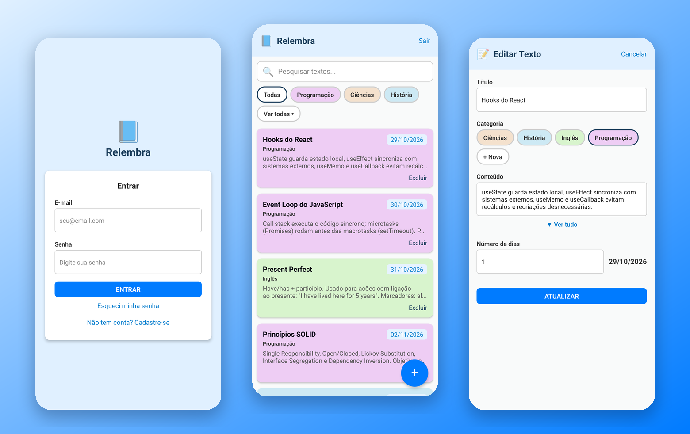
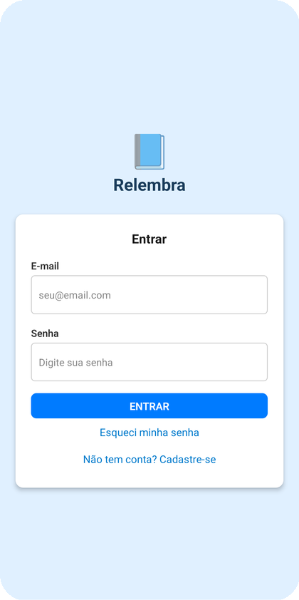
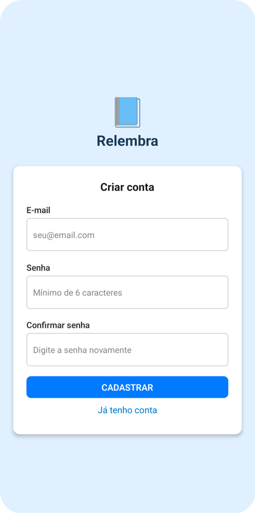
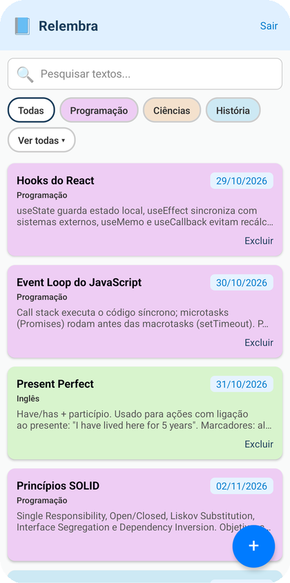
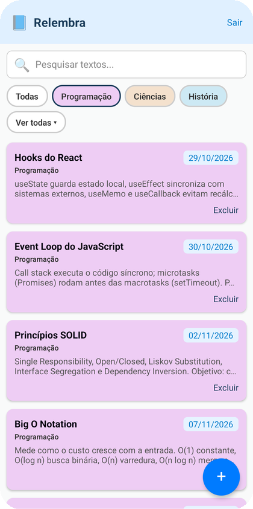
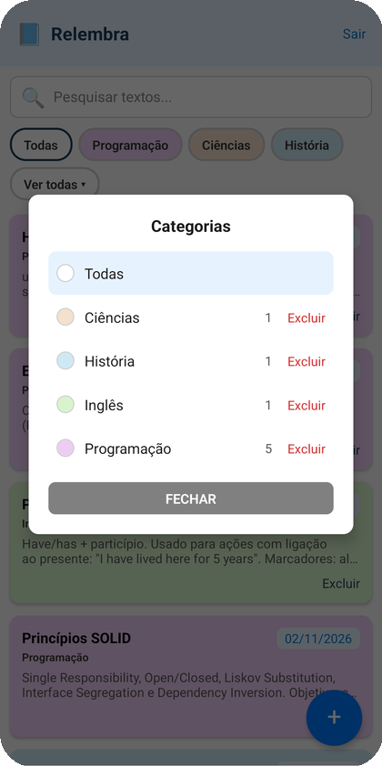
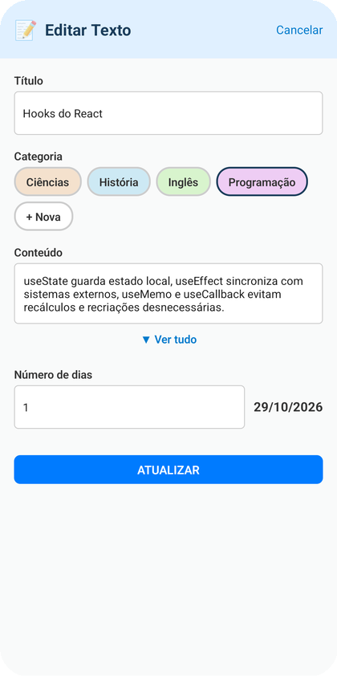
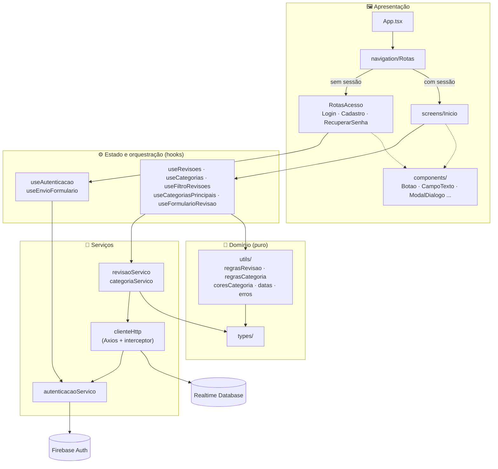
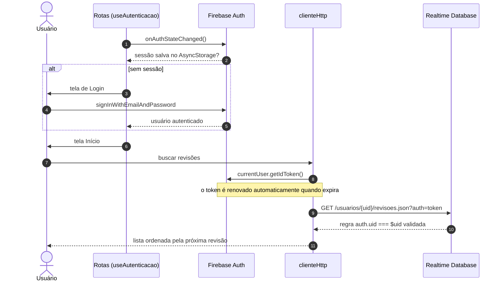

<p align="center">
  
</p>

<p align="center">
  
  
  
  
  
  
  
</p>

<p align="center">
  <a href="#-funcionalidades">Funcionalidades</a> •
  <a href="#-telas">Telas</a> •
  <a href="#-stack">Stack</a> •
  <a href="#-arquitetura">Arquitetura</a> •
  <a href="#-autenticação-e-segurança">Autenticação e segurança</a> •
  <a href="#-decisões-técnicas">Decisões técnicas</a> •
  <a href="#-como-rodar">Como rodar</a>
</p>

---

O **Relembra** é um aplicativo mobile para quem estuda com **revisões programadas**. Você registra um conteúdo, define em quantos dias quer revisá-lo e o app calcula a data e mantém a lista ordenada pela próxima revisão. Cada pessoa tem sua conta, e os dados de cada usuário ficam isolados no servidor por regras de segurança.

O projeto nasceu como uma ferramenta de uso pessoal, que eu uso no dia a dia, e evoluiu para um app multiusuário com arquitetura em camadas, autenticação completa e foco em código limpo.

<p align="center">
  
</p>

## ✨ Funcionalidades

- 🔐 **Conta própria:** cadastro, login e recuperação de senha por e-mail.
- 💾 **Sessão persistente:** o app lembra o usuário entre aberturas.
- 📅 **Agendamento de revisões:** você informa o número de dias e vê na hora a data calculada.
- 🗂️ **Lista ordenada pela próxima revisão:** o que vence primeiro aparece no topo.
- 🏷️ **Categorias com cor própria:** cada categoria nasce com uma cor pastel aleatória, escolhida para ficar bem longe das cores que já existem e sempre legível com o texto escuro do card.
- 🔎 **Busca instantânea** por título e conteúdo, combinada com o **filtro por categoria**: as 3 categorias mais usadas ficam à mão e o "Ver todas" abre a lista completa, com a contagem de revisões e a opção de excluir.
- ✏️ **Criar, editar e excluir**, com confirmação antes de excluir e indicador de progresso em cada ação.
- 🛡️ **Dados isolados por usuário:** cada conta só lê e escreve no próprio nó do banco, com a regra aplicada no servidor.
- 💬 **Mensagens de erro em português:** os códigos do Firebase viram mensagens claras ("E-mail ou senha incorretos", "Este e-mail já está cadastrado"...).

## 📱 Telas

| Login | Cadastro | Lista de revisões |
|:---:|:---:|:---:|
|  |  |  |
| **Filtro por categoria** | **Todas as categorias** | **Edição** |
|  |  |  |

> Os prints foram feitos num aparelho Android real, com uma conta de demonstração.

## 🧰 Stack

| Camada | Tecnologia | Para que serve |
|---|---|---|
| UI | **React Native 0.71** + **React 18** | Interface nativa a partir de componentes funcionais e hooks |
| Linguagem | **TypeScript** | Tipagem do domínio (`Revisao`, `Categoria`, `Usuario`) e das props de cada componente |
| Autenticação | **Firebase Auth (SDK v11)** | Cadastro, login, recuperação de senha e emissão de ID tokens |
| Persistência da sessão | **AsyncStorage** | `getReactNativePersistence` mantém o usuário logado entre aberturas |
| Banco de dados | **Firebase Realtime Database (API REST)** | Armazena revisões e categorias em `/usuarios/{uid}` |
| HTTP | **Axios** | Cliente único, com um interceptor que injeta o token em cada requisição |
| Datas | **date-fns** | Formatação, parsing e soma de dias no padrão `dd/MM/yyyy` |
| Teclado | **react-native-keyboard-aware-scroll-view** | Os formulários de acesso continuam visíveis com o teclado aberto |
| Motor JS | **Hermes** | Inicialização mais rápida e menor consumo de memória no Android |
| Qualidade | **ESLint** (`@react-native-community`) + **Prettier** | Padronização e análise estática |

## 🏛️ Arquitetura

O código está organizado em **camadas com dependências num sentido só**. A interface não conhece o Firebase, os serviços não conhecem React e as regras de negócio são funções puras.



| Camada | Pasta | Responsabilidade |
|---|---|---|
| Apresentação | `screens/`, `components/`, `navigation/` | Renderizar e repassar eventos. Os componentes recebem dados e callbacks por props e não têm regra de negócio |
| Estado | `hooks/`, `screens/*/hooks/` | Guardar estado, disparar efeitos e orquestrar serviços. Fazem o papel de *containers* do padrão container/presentational |
| Serviços | `services/` | Falar com o mundo externo: Firebase Auth e a API REST do Realtime Database |
| Domínio | `types/`, `utils/` | Modelos e funções puras (ordenar por data, filtrar, calcular a data da revisão, traduzir erros), fáceis de testar isoladamente |
| Configuração | `config/`, `theme/` | Configuração do Firebase e paleta de cores centralizada |

### Estrutura de pastas

```text
src/
├── components/          # componentes reutilizáveis (Botao, CampoTexto, ModalDialogo, LayoutAcesso...)
├── config/              # configuração do Firebase
├── hooks/               # hooks compartilhados (useAutenticacao, useEnvioFormulario, useBotaoVoltar)
├── navigation/          # Rotas (logado ou não) e RotasAcesso (login/cadastro/recuperação)
├── screens/
│   ├── Inicio/          # lista de revisões
│   │   ├── components/  # CartaoRevisao, ListaRevisoes, FiltroCategorias, ModalCategorias
│   │   ├── hooks/       # useRevisoes, useCategorias, useCategoriasPrincipais, useFiltroRevisoes, useEdicaoRevisao
│   │   └── index.tsx
│   ├── FormularioRevisao/  # tela de criar/editar revisão (CampoCategoria, CampoDiasRevisao, useFormularioRevisao)
│   ├── Login/
│   ├── Cadastro/
│   └── RecuperarSenha/
├── services/            # firebaseApp, autenticacaoServico, clienteHttp, revisaoServico, categoriaServico
├── theme/               # cores
├── types/               # Revisao, Categoria, Usuario, Credenciais
└── utils/               # regrasRevisao, regrasCategoria, coresCategoria, datas, erros, alertas
```

Cada tela é um módulo com seus próprios `components/` e `hooks/`. O que é genérico sobe para `src/components` e `src/hooks`.

## 🔐 Autenticação e segurança

### Fluxo de sessão



### Modelo de dados e regras

Cada usuário tem um nó próprio, e a regra garante, **no servidor**, que ninguém lê nem escreve fora do próprio `uid`:

```text
usuarios/
└── {uid}/
    ├── categorias/
    │   └── {id}: { nome, cor }
    └── revisoes/
        └── {id}: { titulo, conteudo, numeroRevisao, dataRevisao, categoriaId? }
```

```json
{
  "rules": {
    "usuarios": {
      "$uid": {
        ".read": "auth != null && auth.uid === $uid",
        ".write": "auth != null && auth.uid === $uid"
      }
    }
  }
}
```

> A `apiKey` em `src/config/firebase.ts` é pública por design no Firebase: ela só identifica o projeto. Quem protege os dados são as regras acima, e não o segredo da chave.

## 🧠 Decisões técnicas

- **Hooks como containers.** Toda a lógica (estado, efeitos, chamadas a serviços) vive em hooks como `useRevisoes` e `useFormularioRevisao`. Os componentes ficam declarativos e podem mudar de visual sem tocar na lógica.
- **Token renovado em cada requisição.** Um interceptor do Axios chama `getIdToken()` antes de cada chamada. O SDK devolve o token em cache e renova sozinho quando ele expira (1h), o que evita o erro clássico de sessão persistente com token vencido.
- **Isolamento por regra de segurança.** O caminho `/usuarios/{uid}` vem do usuário autenticado, e a regra `auth.uid === $uid` impede que um cliente adulterado acesse dados de outras contas.
- **Navegação condicional sem biblioteca.** Com quatro telas, um `Rotas` que escolhe entre área logada e área de acesso com base em `onAuthStateChanged` resolve o problema sem dependências extras. O botão voltar do Android é tratado com `BackHandler` num hook próprio.
- **Erros tratados num lugar só.** `useEnvioFormulario` padroniza o estado de envio e de erro dos formulários, e `obterMensagemErro` traduz os códigos do Firebase e erros de validação (`ErroValidacao`) para mensagens amigáveis.
- **Estado derivado em vez de estado duplicado.** A data da revisão é calculada a partir do número de dias a cada renderização, sem `useEffect` para sincronizar dois estados. A busca usa `useMemo`.
- **Cores de categoria legíveis por construção.** A cor é gerada em HSL com saturação e luminosidade fixas (65% e 88%) e só o matiz é sorteado: entre 12 candidatos, fica o mais distante dos matizes já usados. Com a luminosidade travada, todos os textos do card passam no contraste WCAG AA (o pior caso é 4,8:1).
- **Exclusão de categoria atômica.** Apagar uma categoria remove o nó e o `categoriaId` de todas as revisões dela num único `PATCH` multi-caminho, então o banco nunca fica com referências órfãs.
- **Clean code.** Funções pequenas e com uma responsabilidade, nomes que dispensam comentários, estilos com `StyleSheet` e cores centralizadas em `theme/cores.ts`.
- **Domínio em português.** Identificadores no idioma do domínio (`buscarRevisoes`, `CartaoRevisao`, `onExcluir`) e pastas no padrão do ecossistema (`components`, `hooks`, `services`).
- **Migração sem perda de dados.** Na passagem do modelo de usuário único para multiusuário, as revisões existentes foram copiadas para o nó do dono original com um script que confere a quantidade e não sobrescreve nada.

## 🚀 Como rodar

### Pré-requisitos

- Node.js 18+
- JDK 11 ou 17 e Android SDK ([guia oficial do React Native](https://reactnative.dev/docs/environment-setup))
- Um aparelho Android com depuração USB ativa ou um emulador

### Desenvolvimento

```bash
git clone https://github.com/unifkaraujo/relembra.git
cd relembra
npm install

npm start            # terminal 1: Metro bundler
npm run android      # terminal 2: compila e instala no aparelho
```

### APK de release (sem depender do computador)

```bash
npx react-native run-android --mode=release
```

O APK fica em `android/app/build/outputs/apk/release/app-release.apk`.

### Usando o seu próprio Firebase

1. Crie um projeto no [Firebase Console](https://console.firebase.google.com) e ative **Authentication → E-mail/senha** e o **Realtime Database**.
2. Troque os valores em `src/config/firebase.ts` pelos do seu projeto.
3. Publique as regras da seção [Modelo de dados e regras](#modelo-de-dados-e-regras).

### Qualidade

```bash
npx tsc --noEmit     # checagem de tipos
npm run lint         # ESLint
```

## 🗺️ Próximos passos

- [ ] Testes unitários das regras de domínio (`utils/`) e dos hooks com React Native Testing Library
- [ ] Notificações locais no dia da revisão
- [ ] Sugestão automática do próximo intervalo (repetição espaçada progressiva)
- [ ] React Navigation quando o número de telas crescer
- [ ] Build e testes para iOS

---

<p align="center">
  Feito por <a href="https://github.com/unifkaraujo"><b>Kaique</b></a>
</p>
